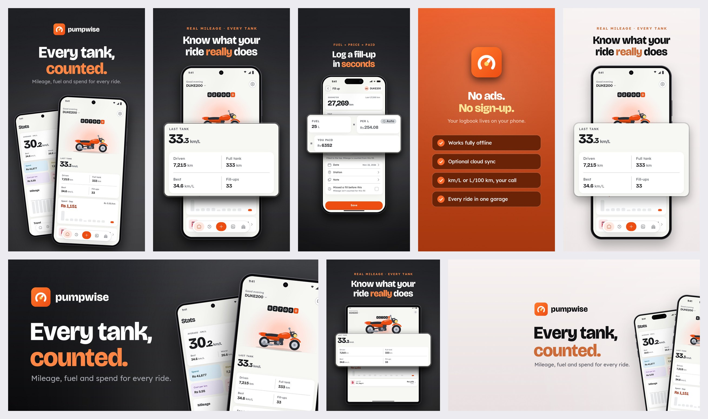
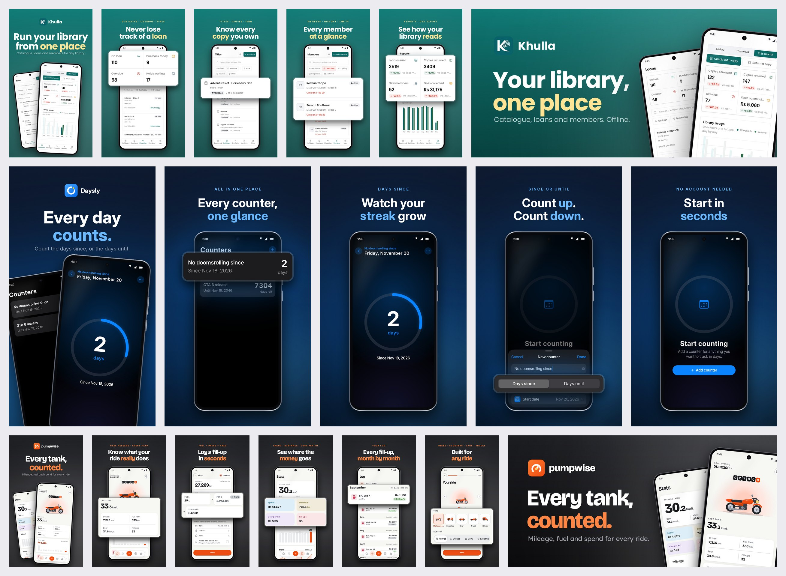
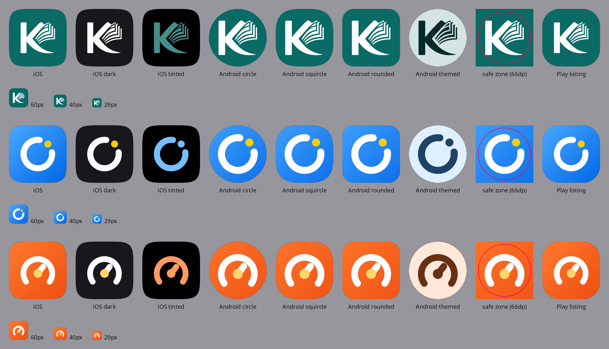

# store-assets

**An agent skill that builds your Google Play and App Store graphics from your app's own codebase.** It covers screenshots, the feature graphic, the iOS 27 header and search art, and every icon, and it validates everything against both stores' specs before you upload.





Tell your agent *"make the store screenshots for this app"*. The skill then:

1. **Reads your brand from the repo:** the accent colour from your theme or tokens, your bundled fonts, the app name and the icon. You get your typography, not a template font.
2. **Plans the story with you:** a hero and 3–7 benefit slides, each showing a real screen. Every headline is tied to a screen that actually exists. It checks with you once, on the copy.
3. **Cleans real captures:** a 9:41 status bar and no notifications. It also turns Android captures into iOS screens (status bar, home indicator, Dynamic Island), so Flutter, React Native and other cross-platform apps get App Store shots **without a Mac**.
4. **Renders deterministically** with Pillow: device frames drawn in code, a soft screen glow, and zoomed callouts of the part that matters. Re-run it after a UI change and you get the same design with the new pixels.
5. **Makes every icon:** Play 512, App Store 1024, Xcode appiconset with **dark and tinted** variants, a starter **Icon Composer** bundle for Liquid Glass, and Android **adaptive and themed** (monochrome) icons auto-fitted to the 66dp safe zone. It also writes a preview of every mask.
6. **Validates before you upload:** pixel sizes, no alpha, counts per store and locale, file sizes, colour profile, and the copy (no "best", "#1" or "free", no other platform's name).



## Why another screenshot skill?

| | store-assets | Typical alternatives |
|---|---|---|
| Both stores, one design | Play phone and tablets, feature graphic, iPhone, iPad, iOS 27 header and search | Often Apple only, or Play as an afterthought |
| Real UI | Always your captures; never AI-redrawn screens | Some regenerate the UI with image models, which risks Guideline 2.3 |
| Brand | Read from your code: tokens, theme, fonts | Presets, or asking you for hex codes |
| Icons | Full set, including adaptive, themed, iOS dark/tinted and Icon Composer | Usually none |
| iOS without a Mac | Captures at the iOS aspect on Android, then re-chromed | Requires the iOS Simulator |
| Validation | `check.py` fails loudly on anything a store would reject | Rarely |
| Runtime | Python and Pillow, offline, headless, runs in CI | Node and Chrome, a Next.js editor, or paid image APIs |

## Install

store-assets is a standard [Agent Skill](https://agentskills.io) (`skills/store-assets/SKILL.md`), so it works in any harness that reads skills. The repo also ships native plugin manifests for the big ones.

**Any agent, one command** ([`skills` CLI](https://github.com/vercel-labs/skills): Claude Code, Codex, Cursor, Gemini CLI, GitHub Copilot, OpenCode, Windsurf, Goose, Kiro and many more):

```bash
npx skills add sawongam/store-assets          # this project
npx skills add sawongam/store-assets -g       # every project
npx skills add sawongam/store-assets -a codex -a cursor   # pick agents
```

**Claude Code** (plugin marketplace):

```
/plugin marketplace add sawongam/store-assets
/plugin install store-assets@store-assets
```

**Codex** (plugin, from `.codex-plugin/plugin.json`):

```bash
codex plugin marketplace add sawongam/store-assets
```

Then install it from the Plugins directory.

**Gemini CLI** (extension, from `gemini-extension.json`):

```bash
gemini extensions install https://github.com/sawongam/store-assets
```

**Cursor:** use `npx skills add … -a cursor`. The repo also has a `.cursor-plugin/plugin.json` for the Cursor marketplace.

**Manual:** copy or symlink `skills/store-assets/` into your agent's skills folder:

| Agent | Project | Global |
|---|---|---|
| Claude Code | `.claude/skills/` | `~/.claude/skills/` |
| Codex, Cursor, Gemini CLI, Copilot, OpenCode, Amp | `.agents/skills/` | `~/.agents/skills/` (Codex), `~/.cursor/skills/`, `~/.gemini/skills/`, `~/.copilot/skills/`, `~/.config/opencode/skills/` |
| Windsurf | `.windsurf/skills/` | `~/.codeium/windsurf/skills/` |

```bash
git clone https://github.com/sawongam/store-assets
ln -s "$PWD/store-assets/skills/store-assets" ~/.claude/skills/store-assets
```

**Requirements:**

- Python 3.9+ and Pillow 10.1+ (`python3 -m pip install pillow`). The scripts say so in one line if either is missing.
- Optional:
  - `rsvg-convert` or `pip install cairosvg`, for SVG icons
  - `adb`, for Android captures
  - Xcode's `xcrun simctl`, for iOS captures

## Use

In your app's repo, ask in plain words:

- "Make Play Store and App Store screenshots for this app"
- "Generate all the app icons from `branding/mark.svg`, including the Android themed icon"
- "Our UI changed, re-render the store screenshots"
- "Add German store screenshots"
- "Make a feature graphic"

The skill keeps everything in `store-assets/` in your repo:

```
store-assets/
├── config.json          # brand, captures, slides, copy: commit this
├── raw/phone/…          # your captures
└── out/                 # rendered, upload-ready (gitignore it, or don't)
    ├── play/en-US/{phone,tablet-7,tablet-10}/01_hero.jpg … feature-graphic.jpg
    ├── appstore/en-US/{iphone-6.9,iphone-6.3,ipad-13}/…
    ├── icons/{play,appstore,android,icon-composer}/…
    └── _review/sheet-en-US.jpg
```

You can also run the scripts directly:

```bash
S=~/.claude/skills/store-assets/scripts        # wherever the skill is installed
python3 $S/scan_brand.py .                     # what's in this repo
python3 $S/inspect_capture.py raw/phone/*.png  # measure status/nav bars
python3 $S/render.py                           # render everything
python3 $S/render.py --only play-phone --slides 02_mileage
python3 $S/icons.py --mark branding/mark.svg --bg "#FF7A2E,#EE4D12"
python3 $S/check.py                            # validate; exit 1 on problems
python3 $S/render.py --fastlane fastlane       # + fastlane supply/deliver layout
```

## What it makes

| Target | Size | Notes |
|---|---|---|
| `play-phone` | 1080×1920 | 2–8, 4+ for promotion slots |
| `play-tablet-7` / `play-tablet-10` | 1440×2560 / 1800×3200 | |
| `play-feature-graphic` | 1024×500 | required to publish |
| `ios-iphone-6.9` / `ios-iphone-6.3` | 1320×2868 / 1206×2622 | |
| `ios-ipad-13` | 2064×2752 | if the app runs on iPad |
| `ios-header` / `ios-search` | 3840×1646 / 3840×2560 | iOS 27+; experimental safe areas |
| Icons | 512, 1024, appiconset, `.icon`, Android res | `icons.py` |

The specs live in [`specs.json`](skills/store-assets/scripts/specs.json), dated and with source links. Stores change sizes, and when that happens the file is the one place to update.

## Honest limits

- **Device frames** are drawn in code to look like generic devices, not exact replicas of specific phones. Use `frame: "none"` for a frameless look, which Play also prefers for promotion slots.
- **Re-chromed iOS screens** keep your app's Android-style widgets (back arrows, switches). The skill warns for every such screen. Check them against a real iOS build.
- **iOS 27 header and search safe areas** are estimates until Apple publishes numbers. Confirm placement in App Store Connect's preview.
- **The Icon Composer bundle** is a starting point. Open it in Icon Composer to tune the glass before shipping.
- **No app preview videos.**

## Contributing

Issues and PRs are welcome, especially new layouts, device frames, and spec updates with a link to the store page.

```bash
python3 -m pip install pillow
python3 -m unittest discover -s tests -v
```

The tests build synthetic captures, so no emulator or real app is needed. CI runs them on Linux, macOS and Windows. [`AGENTS.md`](AGENTS.md) has the repo layout and the release rules (every manifest's version moves together).

## License

MIT
